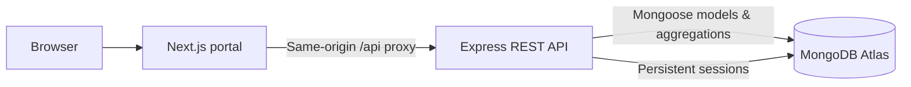

# DoctorTracker API

**The secure, database-backed service behind DoctorTracker.** A standalone REST API for administrator authentication, doctor and patient records, searchable directories and live analytics.

[](https://doctor-tracker-api-tg86.onrender.com/api/health)
[](https://doctor-tracker-frontend.onrender.com/login)

[](https://github.com/sajeeb-ahmeed/Doctor-Tracker-API/actions/workflows/ci.yml)


**[Try the live portal](https://doctor-tracker-frontend.onrender.com/login)** · **[API health](https://doctor-tracker-api-tg86.onrender.com/api/health)** · **[Frontend source](https://github.com/sajeeb-ahmeed/Doctor-Tracker-Portal)** · **[Endpoint reference](#api)**

> **Demo scope:** Administrator-only workflows; synthetic doctors/patients. Not a patient-facing app and not intended for real medical records.

## Hosted services

| Service | Live URL |
| --- | --- |
| Premium Next.js frontend | [doctor-tracker-frontend.onrender.com](https://doctor-tracker-frontend.onrender.com/login) |
| Express REST API | [doctor-tracker-api-tg86.onrender.com](https://doctor-tracker-api-tg86.onrender.com/api/health) |
| Database | MongoDB Atlas, dedicated `doctor_tracker` database |

Browser requests use the frontend's same-origin `/api/*` rewrite, preserving secure server-side sessions. All public health and authentication checks are documented in the [frontend verification workflow](https://github.com/sajeeb-ahmeed/Doctor-Tracker-Portal/actions/workflows/check-doctortracker-hosting.yml).

```bash
# Public health check (does not require credentials)
curl --fail --silent --show-error https://doctor-tracker-api-tg86.onrender.com/api/health
```

---

## Local setup

Requirements: Node.js 22+ (Node.js 24 recommended) and npm. A separate MongoDB installation is optional for local development.

```powershell
git clone https://github.com/sajeeb-ahmeed/Doctor-Tracker-API.git
cd Doctor-Tracker-API
npm ci
npm run dev:local
```

The API listens on `http://localhost:4000`. The first start downloads and launches a **real MongoDB 8.0 process** using `mongodb-memory-server`, with WiredTiger storage persisted in `.data/mongodb`. Subsequent starts preserve records. No API path uses hardcoded or in-memory substitutes for database operations. The local database is bound to loopback. Internet access is required for the first MongoDB binary download.

`dev:local` opts into idempotent synthetic seeding, supplying 14 doctors and 84 patients across varied dates, specialties, conditions, and statuses. Existing records are preserved on restart. Demo credentials:

```text
Email: admin@doctortracker.demo
Password: DoctorDemo!2030
```

For customized settings, copy `.env.example` to `.env`. An explicit `SEED_DEMO=false` keeps the sample data disabled even with `dev:local`. `npm run dev` does not opt into demo seeding. Both commands create the configured administrator only if that email does not already exist. Password changes to `.env` do not silently overwrite an existing account.

### An installed or Docker MongoDB

```powershell
docker compose up -d
Copy-Item .env.example .env
```

Set `MONGODB_URI=mongodb://127.0.0.1:27017/doctor_tracker` in `.env`, then run `npm run dev:local`. Docker uses the named `doctor-tracker-mongo` volume; the automatic local MongoDB launcher is skipped whenever a URI is configured. To explicitly seed an existing development database, run `npm run seed`.

### Commands

| Command             | Purpose                                                                   |
| ------------------- | ------------------------------------------------------------------------- |
| `npm run dev:local` | Watch-mode API plus persistent local MongoDB and demo seed                |
| `npm run dev`       | Watch-mode API respecting `.env`; demo seed only when enabled             |
| `npm run seed`      | Create the admin and explicitly seed demo records if there are no doctors |
| `npm run check`     | Strict TypeScript check                                                   |
| `npm test`          | Integration tests against real, isolated MongoDB                          |
| `npm run build`     | Compile the standalone API into `dist/`                                   |
| `npm start`         | Run compiled API                                                          |

## Environment

| Variable          | Local behavior                             | Production requirement                                               |
| ----------------- | ------------------------------------------ | -------------------------------------------------------------------- |
| `PORT`            | `4000`                                     | Hosting platform usually sets it                                     |
| `MONGODB_URI`     | Blank starts persistent local MongoDB      | Required hosted MongoDB URI                                          |
| `FRONTEND_ORIGIN` | `http://localhost:3000`                    | Exact HTTPS frontend origin; multiple origins may be comma-separated |
| `SESSION_SECRET`  | Random process-specific development secret | Required, at least 32 random characters                              |
| `ADMIN_EMAIL`     | `admin@doctortracker.demo`                 | Configure the administrator email                                    |
| `ADMIN_NAME`      | `Alex Morgan`                              | Configure a display name                                             |
| `ADMIN_PASSWORD`  | Local demo password                        | Required, at least 12 characters; choose a unique password           |
| `SEED_DEMO`       | `false`; local launcher opts into `true`   | `false` by default; `true` only for an intentional synthetic demo    |

Production startup fails before listening if MongoDB or secure administrator/session settings are missing. Keep `.env` files and database data outside Git. To generate a session secret locally: `node -e "console.log(require('node:crypto').randomBytes(48).toString('hex'))"`.

## Architecture and decisions



1. **MongoDB-backed sessions instead of client-stored authentication tokens.** Passwords use bcrypt with a work factor of 12. Login regenerates the session ID; logout destroys it in MongoDB. The browser receives only an opaque eight-hour `dt.sid` cookie with HttpOnly, SameSite=Lax, and Secure in production. Next.js should proxy `/api/*` to the backend so deployed frontend and backend domains work with these cookies. Never expose the API origin as the browser's direct cross-site login endpoint without deliberately revisiting cookie policy.
2. **One doctor reference per patient and server-side queries.** A required `doctorId` keeps assignment explicit. Doctor counts and dashboard metrics use aggregation; list responses calculate counts on the backend and populate only the returned patient page. Date, doctor, condition, hospital, specialty, and status filters use compound indexes. New records immediately affect analytics. There is no duplicated patient-count field to drift out of sync after deletion.

The API is split into configuration, database lifecycle, Mongoose models, validation, serializers, seed logic, HTTP routes, and centralized error handling. Request bodies use strict schemas, pagination is capped at 50 rows, ObjectIds and calendar dates are validated, and errors use a consistent JSON envelope.

Search uses case-insensitive **word prefixes** across useful fields: `sara card` can match Sarah in Cardiology, while `arah` does not match Sarah. Unicode words are normalized and stored as a hidden `searchTokens` array; each query word uses a case-sensitive anchored prefix over those normalized tokens. MongoDB can derive bounded scans on its multikey search indexes, with compound indexes for combined filters. Regex metacharacters never become executable patterns, and MongoDB operators from request bodies are rejected. Tokens are refreshed on create/update and older records are backfilled on startup. Tests verify `explain('executionStats')` uses an `IXSCAN` and examines fewer than 10 documents for a selective query in a 251-doctor fixture. For typo tolerance, arbitrary infix matching, or substantially larger datasets, Atlas Search is a future extension. Indexes are declared in `src/models.ts`.

## Data semantics

- Doctor fields: name, specialization, hospital, phone, email, timestamps, computed patient count.
- Patient fields: name, age (0–120), gender (`Female`, `Male`, `Other`), condition, status (`Active`, `Recovered`, `Critical`), phone, optional email, doctor assignment, timestamps.
- Doctor and patient phone values must contain 7–15 digits and fit within 25 characters. Spaces, `+`, parentheses, periods, and hyphens are accepted for formatting; a value made only of formatting characters is rejected.
- Each patient has exactly one existing doctor. Editing a patient can reassign that doctor.
- Deleting a patient from a doctor's page permanently deletes the same record from the global patient list and dashboard. It is not merely an unassignment.
- Dates filter `createdAt`, in **UTC**, with inclusive `from` and `to` calendar dates. Newest-first pagination uses `createdAt` plus `_id` for stable ordering.
- Dashboard totals respect the selected date range. Active patients include `Active` and `Critical` records. Per-doctor chart counts patient registrations in that range across the doctor directory. Without dates, totals are all-time and the registration chart shows the most recent 30 days. Selected chart windows longer than 90 days aggregate by month.
- Authorization is administrator-only. The specification does not require registration, password reset, doctor deletion/editing, or appointments; these are outside this deliverable.

## API

`GET /api/health` is public. Login requires the request-verification header. All other business endpoints require an authenticated administrator session.

Every `POST`, `PATCH`, or `DELETE` must send:

```http
Content-Type: application/json
X-Requested-With: DoctorTracker
```

If an `Origin` header is present, it must match a configured frontend origin. CORS allows credentials only for those origins. Login is rate-limited to 20 failed attempts per IP per 15 minutes. Authentication, validation, and resource errors use `{ "error": { "message": "...", "fields": { "field": "..." } } }`; `fields` is optional.

| Method   | Endpoint                    | Purpose                                                                 |
| -------- | --------------------------- | ----------------------------------------------------------------------- |
| `GET`    | `/api/health`               | API/MongoDB readiness; 503 if disconnected                              |
| `POST`   | `/api/auth/login`           | `{email,password}`; create session                                      |
| `GET`    | `/api/auth/me`              | Current `{id,name,email,role}`                                          |
| `POST`   | `/api/auth/logout`          | Destroy session                                                         |
| `GET`    | `/api/doctors`              | Search/filter/paginate doctors                                          |
| `POST`   | `/api/doctors`              | Create doctor                                                           |
| `GET`    | `/api/doctors/:id`          | Doctor plus patient count                                               |
| `GET`    | `/api/doctors/:id/patients` | Search/filter/paginate assigned patients                                |
| `GET`    | `/api/patients`             | Search/filter/paginate patients                                         |
| `POST`   | `/api/patients`             | Create assigned patient                                                 |
| `PATCH`  | `/api/patients/:id`         | Update one or more editable fields                                      |
| `DELETE` | `/api/patients/:id`         | Permanently delete patient                                              |
| `GET`    | `/api/meta`                 | Current filter options and doctor choices                               |
| `GET`    | `/api/dashboard`            | Totals, registrations, patients per doctor, conditions, recent patients |

List query parameters: `q`, `page` (default 1), `limit` (default 10, max 50), `from`, `to`. Doctor lists additionally accept exact `specialization` and `hospital`. Patient lists accept exact `doctorId`, `condition`, and `status`. Dashboard accepts `from` and `to`. Unknown or duplicate query fields are rejected.

Lists return `{data: [...], pagination: {page, limit, total, totalPages}}`; single resources and metadata return `{data: ...}`. Creates return 201. IDs and dates are serialized as strings. Patient responses include the assigned `doctor: {id,name,specialization}`.

## Deployment

**Current public API:** [https://doctor-tracker-api-tg86.onrender.com/api/health](https://doctor-tracker-api-tg86.onrender.com/api/health). The backend is hosted on Render Free and connects to MongoDB Atlas using credentials stored only in Render environment settings. The project owner confirmed successful login through the separately deployed frontend; automated smoke tests verify health, API forwarding and unauthorized access handling.

The included `render.yaml` configures a standalone Render web service, a build command of `npm ci --include=dev && npm run build`, start command `npm start`, and readiness route `/api/health`. Including development dependencies during installation supplies TypeScript and its type declarations for compilation even when `NODE_ENV=production` is configured.

1. Create a MongoDB Atlas database and restricted database user. Permit the hosting platform's outbound network access.
2. Import this repository as a Render service or Blueprint. Configure `MONGODB_URI`, exact `FRONTEND_ORIGIN`, administrator settings, and a generated `SESSION_SECRET`. Keep demo seeding disabled unless publishing an intentionally synthetic evaluation demo.
3. Deploy the frontend as a separate Node.js web service on Render (as in the [live example](https://doctor-tracker-frontend.onrender.com/login)), or on another Next.js-capable host such as Netlify. Configure its server-side `BACKEND_URL` to the Render API origin, without `/api`, for both build and runtime. Route browser `/api/*` requests through the frontend rewrite and preserve the authentication, cookie, and HTTPS forwarding behavior.
4. Verify `/api/health`, login, create/edit/delete, logout, and data persistence on the deployed frontend before calling the deployment complete.

For another host, `Dockerfile` builds a non-root production image. Production never downloads or starts the local MongoDB binary; its database must be externally managed.

See the frontend repository for desktop/mobile screenshots, the application UI, and frontend deployment settings: [Doctor-Tracker-Portal](https://github.com/sajeeb-ahmeed/Doctor-Tracker-Portal).

## Validation and references

Integration tests validate authentication/logout, CSRF/origin defenses, doctor and patient CRUD, duplicate emails, strict input validation, inclusive date filters, combined search/filter pagination, and real dashboard updates after mutation. The suite uses an isolated real MongoDB process, never the developer's database.

Implementation references: [Express production security](https://expressjs.com/en/advanced/best-practice-security/), [Mongoose schemas and indexes](https://mongoosejs.com/docs/guide.html), and [MongoDB compound index guidance](https://www.mongodb.com/docs/manual/tutorial/equality-sort-range-guideline/).

## Project maintenance

- [Contribution guidelines](CONTRIBUTING.md)
- [Changelog](CHANGELOG.md)
- [Bug reports](.github/ISSUE_TEMPLATE/bug_report.md) and [feature requests](.github/ISSUE_TEMPLATE/feature_request.md)

**Keywords:** REST API, Node.js, Express, TypeScript, Mongoose, MongoDB Atlas, session authentication, doctor management, patient management, healthcare admin dashboard.
